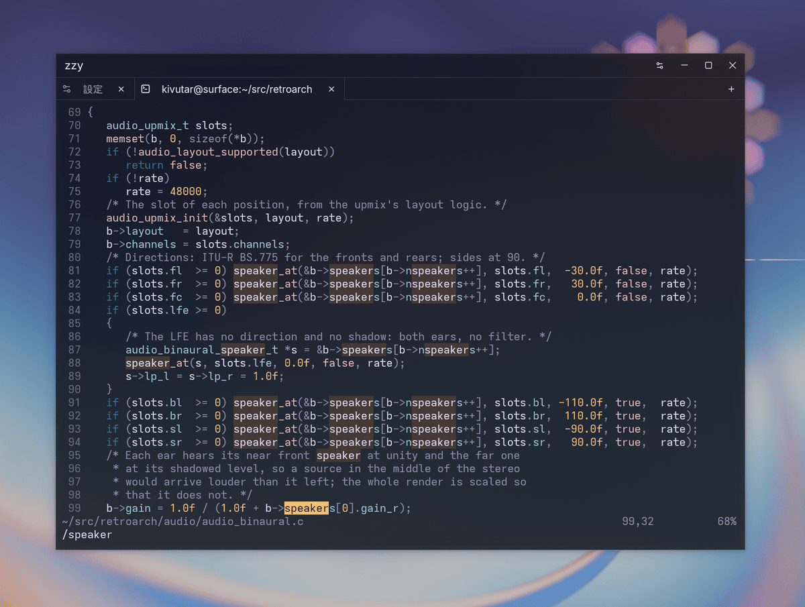

# zzy

zzy is a GPU-rendered terminal emulator, built with [GPUI](https://www.gpui.rs/)
(the UI framework behind the Zed editor) and
[alacritty_terminal](https://crates.io/crates/alacritty_terminal) for terminal
emulation. It is an independent project, not affiliated with Zed Industries.



Features:
- Tabs
- Themes and adjustable window opacity, with background blur
- A red window tint while running as root, and a green one during SSH sessions
- Settings editable from a built-in panel, saved to
  `~/.config/zzy/settings.toml`
- English and Japanese interface, following the system language by default

## Download

Builds for Linux, Windows and macOS, on x86_64 and arm64, are on the
[releases page](https://github.com/kivutar/zzy/releases).

- **Linux:** needs glibc 2.35 or newer (Ubuntu 22.04, Debian 12, Fedora 36
  and later). The archive also holds the desktop entry and icon.
- **Windows:** a single `zzy.exe`, no runtime to install. It isn't signed yet,
  so SmartScreen may ask for confirmation on first launch.
- **macOS:** the binary isn't signed or notarized yet; after extracting, clear
  the quarantine flag with `xattr -d com.apple.quarantine zzy`.

## Building

You need a recent stable Rust toolchain ([rustup](https://rustup.rs/)) and the
system libraries GPUI uses on Linux: Vulkan, Wayland/X11, xkbcommon,
fontconfig and freetype.

On Arch Linux:

```sh
sudo pacman -S --needed base-devel vulkan-icd-loader wayland libxkbcommon libxkbcommon-x11 libxcb fontconfig freetype2
```

On Debian/Ubuntu:

```sh
sudo apt install build-essential pkg-config libvulkan1 libwayland-dev libxkbcommon-dev libxkbcommon-x11-dev libxcb1-dev libfontconfig-dev libfreetype-dev
```

Then build and run:

```sh
cargo run --release
```

## Installing

Build as your normal user, then install the binary, desktop entry and icon:

```sh
cargo build --release
sudo install -Dm755 target/release/zzy /usr/local/bin/zzy
sudo install -Dm644 assets/linux/zzy.desktop /usr/local/share/applications/zzy.desktop
sudo install -Dm644 assets/icons/hicolor/scalable/apps/zzy.svg /usr/local/share/icons/hicolor/scalable/apps/zzy.svg
```
